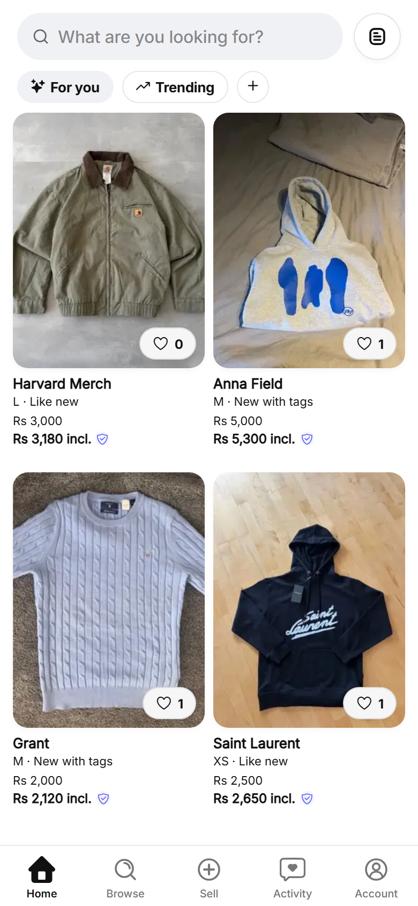
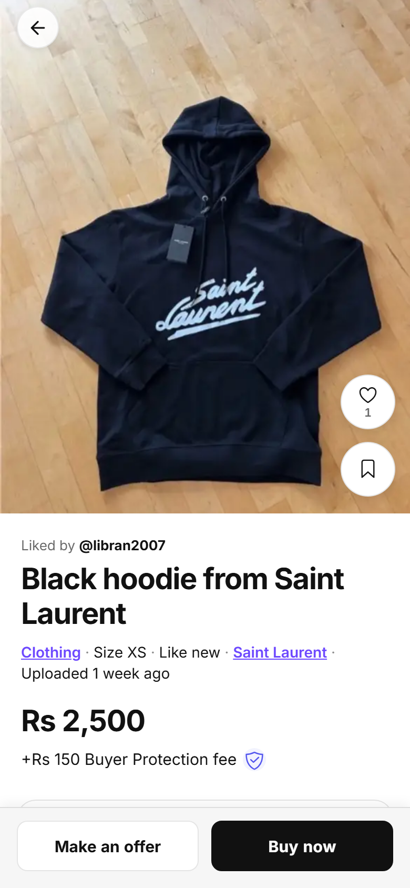

# Grabsty

A peer-to-peer marketplace for secondhand fashion in Pakistan (PKR). Sellers list clothes, shoes and accessories; buyers browse, message, make offers and pay through Stripe with a Buyer Protection fee.

**Live web build:** https://ceranix.vercel.app

Built solo, end to end: product design, mobile/web app, database, payments, CI/CD and testing (560+ commits).

<p>
  
  &nbsp;
  
</p>

## Features

- **Listings:** multi-image upload with a bundle collage, size/condition/brand, client-side thumbnails
- **Discovery:** home feed (For you / Trending), search and browse
- **Messaging and offers:** buyer–seller conversations and price offers
- **Checkout:** Stripe checkout session and webhook handled in Supabase Edge Functions, Buyer Protection fee, orders and invoices
- **Trust:** ratings, computed seller levels and completion stats
- **Accounts:** auth, onboarding, profiles, friends, wardrobe, settings, account deletion
- **Push notifications** (Expo Notifications + an Edge Function)
- **Admin** screens for order logistics

## Tech stack

| Area | Tools |
|---|---|
| App | React Native, Expo SDK 54, Expo Router, TypeScript |
| UI | NativeWind (Tailwind CSS), FlashList, Expo Image |
| Data | TanStack Query (with offline persistence), React Hook Form + Zod |
| Backend | Supabase: Postgres, Row Level Security, Storage, Auth, Edge Functions (Deno) |
| Payments | Stripe (checkout sessions + webhooks) |
| Monitoring | Sentry, PostHog |
| Testing | Vitest (unit), Playwright (end-to-end) |
| CI/CD | GitHub Actions, EAS Build, Vercel |

## Engineering notes

- **Database:** 28 SQL migrations with Row Level Security on user data; tuned queries and policies for the home feed.
- **CI (GitHub Actions):** typecheck, ESLint, Vitest, web build with bundle-size report, `npm audit`, CodeQL, gitleaks secret scanning, Supabase migration checks, Playwright E2E, and Vercel preview/production deploys.
- **Security:** dependency review, secret scanning and a security audit before launch (see `SECURITY_AUDIT.md`).
- **Docs:** product, design and backend decisions are written down in `PRODUCT.md`, `DESIGN.md`, `BACKEND_BLUEPRINT.md` and `docs/`.

## Project structure

```
app/                 Expo Router screens (tabs, product, sell, orders, payment, admin, ...)
components/          Reusable UI
hooks/ lib/ context/ Data access, Supabase client, state
supabase/migrations  Postgres schema + RLS policies
supabase/functions   Edge Functions: create-checkout-session, stripe-webhook, send-push, delete-account
tests/               Vitest unit tests and Playwright E2E specs
.github/workflows/   CI, CodeQL, secret scan, E2E, EAS and Vercel deploys
```

## Run locally

```bash
npm install
cp .env.example .env    # add your Supabase URL/anon key and Stripe publishable key
npm start               # Expo dev server (press w for web, a for Android)
npm test                # unit tests
npm run test:e2e        # Playwright end-to-end tests
```

## Author

**Muhammad Ahmad Saleem**, Software Engineer (React / React Native, TypeScript, Python, AI integrations), Lahore, Pakistan
[LinkedIn](https://www.linkedin.com/in/ahmad-saleemm) · [GitHub](https://github.com/Ahmad1765) · flyluckyfire@gmail.com
